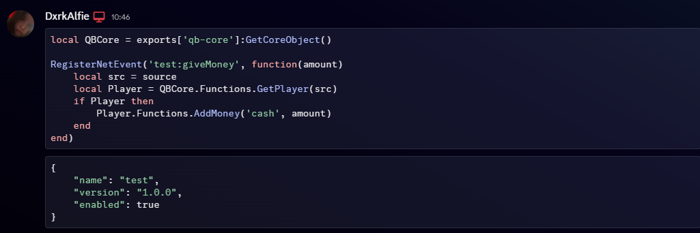

# autoCodeblock
Wraps pasted code in a codeblock automatically

## Showcase


## Install

Build Vencord from source, put this folder in `src/userplugins/autoCodeblock`, then run:

```sh
pnpm build
```

See https://docs.vencord.dev/installing/custom-plugins/ if you have not built Vencord before.

Restart Discord, then enable AutoCodeblock under Settings > Plugins.

## Usage

Send a message with 3 or more lines of code and it gets wrapped in a codeblock with the detected language (Lua, JS, Python, JSON, HTML, CSS, SQL). Start a message with `!raw ` to send it as-is.

## License

GPL-3.0-or-later
